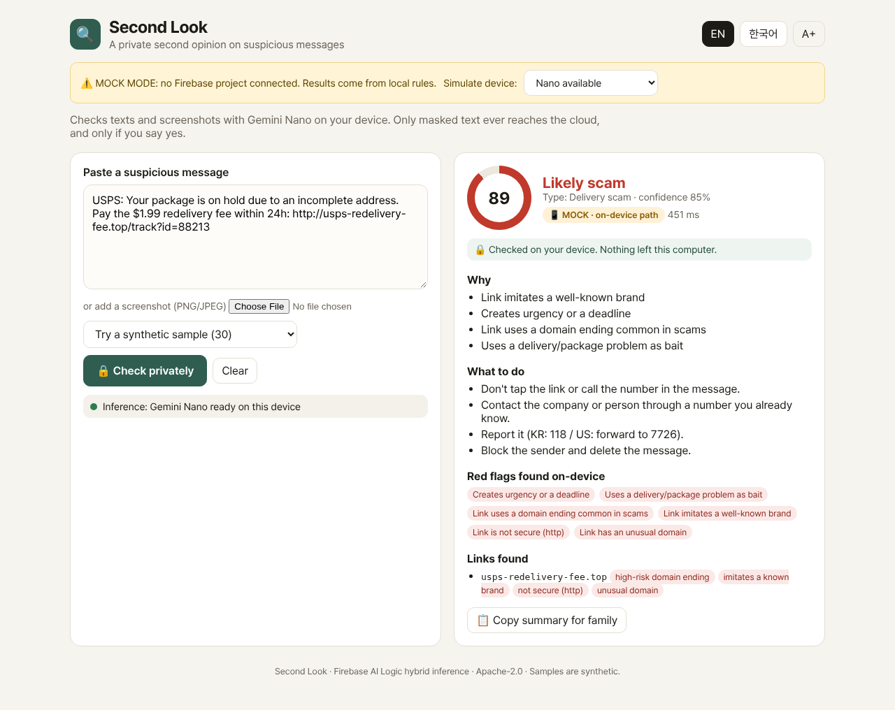
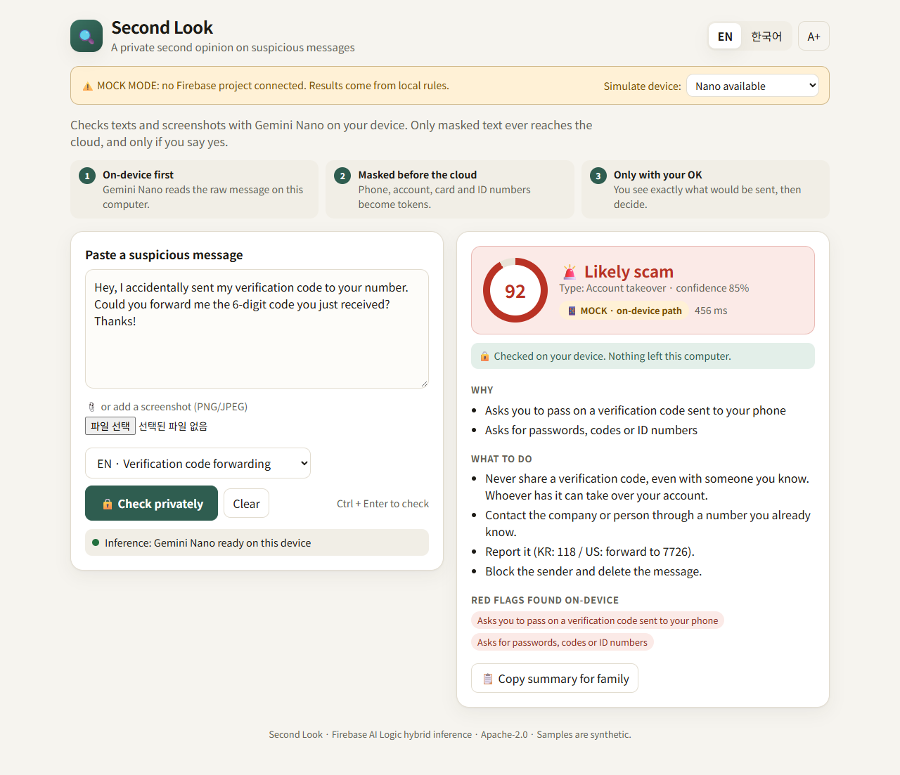

# Second Look 🔍

**A second opinion on suspicious texts.** Paste a text your parent forwarded to you (or add a screenshot). Second Look uses **Firebase AI Logic hybrid inference** with one rule: the raw message is only ever given to **Gemini Nano on your own device** (`ONLY_ON_DEVICE`). If there is no local model, or the message is in a language the app doesn't route to Nano (Korean, for example), it masks the phone, account, card, ID and code numbers it recognises, shows you the exact text that would be sent, and waits for your OK before asking Gemini in the cloud.

Built for the Firebase **#BuildHybridAI 2026** hackathon (Web / Chrome).


*Captured in mock mode (simulated on-device path, local rules). Not yet a capture from real Gemini Nano.*

## Who it's for
I live in Korea, and my parents get smishing texts in Korean. The quick way to get help is to paste the text into a chatbot, which uploads whatever is in it: phone numbers, bank accounts, sometimes a resident registration number. Second Look is for the family member a parent forwards that text to, sitting at a desktop Chrome.

## How routing works

| Situation | What Second Look does | Firebase AI Logic mode |
|---|---|---|
| Nano ready + a language the app routes to it (en/ja/es/de/fr) | Raw text is checked on-device only | `InferenceMode.ONLY_ON_DEVICE` |
| No usable local model, same languages | Mask on-device → show the exact text → consent → hybrid call | `InferenceMode.PREFER_ON_DEVICE` (masked text, plus the screenshot as is if you attached one) |
| Korean or another language not routed to Nano | Mask → preview → consent → cloud | `InferenceMode.ONLY_IN_CLOUD` (masked text, plus the screenshot as is if attached) |
| Screenshot with no pasted text | The language is unknown, so it never goes to Nano. Preview → consent → cloud, with the screenshot sent **unmasked** | `InferenceMode.ONLY_IN_CLOUD` |
| On-device verdict is "Be careful" or low-confidence, or the on-device call failed | Optional cloud check (masked text, plus any screenshot as is, after consent). The on-device score stays visible | `InferenceMode.ONLY_IN_CLOUD` |
| Follow-up questions on a cloud result | One chat session per result, masked context | `ONLY_IN_CLOUD` + `startChat` |
| Offline with no model, consent declined, or the model call fails | Local red-flag rules only | none |

The routing is done by hand on purpose. The SDK's fallback would happily send raw text to the cloud when Nano isn't ready, so raw text is only ever given to `ONLY_ON_DEVICE`, which fails rather than uploads. `PREFER_ON_DEVICE` only ever sees masked text, after consent. The decision lives in one pure function, `decideRoute()` in `src/route.ts`. The tests check that every model call made by `runCheck()` and `secondOpinion()` gets exactly the masked text when it can reach the cloud, and follow-up questions go through the same masking function. An English screenshot with no pasted text also goes to the cloud; paste the text as well if you want it checked on-device.

Each result has a badge showing where inference ran, read from `response.inferenceSource`. If a `PREFER_ON_DEVICE` call ends up running on the device, the note says so instead of claiming the cloud was used.

## Features
- Risk score (0-100), level, scam type, reasons and concrete next steps. Structured JSON on-device via Chrome's `responseConstraint`, in the cloud via `responseSchema`. The level is always derived from the score.
- **On-device masking** (`src/pii.ts`, plain regex, no network): Korean RRNs, card numbers (incl. 15-digit Amex, Luhn-checked), phone numbers (KR, US with spaces/dots/dashes, `+44`-style international), bank accounts, US SSNs, verification codes after words like "code" or "인증번호", emails, plus a fallback for any other run of 7+ digits. Dates and money amounts are left alone. Inside links, the host is kept (so you can see where a link goes) and numbers or emails in the path and query are masked.
- **What masking does not catch:** names, street addresses and other free text. That's why the consent dialog shows the literal text before anything is sent, and says so.
- **Link analysis on-device:** shorteners, raw IPs, punycode look-alikes, risky TLDs (also for bare domains like `prize.icu`), brand look-alikes (`usps-redelivery-fee.top`, `paypal-secure.top`), and `user@host` tricks like `http://paypal.com@evil.top/`. An email inside a link is masked without turning off the link check.
- Local red-flag rules in English and Korean (urgency, money/credential requests, family/authority impersonation, delivery/prize/loan/investment lures, obituary/wedding-link lures…). English rules use word boundaries, so "first" doesn't trigger "IRS" and "won't" doesn't count as "you won".
- **Local rules as a floor under the model.** A request to forward a verification code is a critical signal that keeps the result at high risk. If the rules alone say "Likely scam" and the model says "Looks OK", the app shows at least "Be careful" and says the two disagree. Text that copies the prompt's message markers is neutralized before it reaches the model (a basic defense, not a guarantee).
- **If a model call fails** (rate limit, App Check, network, input too long), you get the local-rules verdict with a plain-language note instead of an error card. If the request had already gone to the cloud, the note says what was sent. A screenshot-only check has no text to score, so it shows the error and asks you to paste the text.
- Screenshot input (PNG/JPEG). Screenshots can't be masked, so the dialog, the result note and the badge all say when one was sent as is.
- English + Korean UI, large-text mode, light/dark theme following your system setting, Ctrl+Enter to check, "copy summary for family".
- 30 **synthetic** test messages (15 EN, 15 KO) in `src/samples.ts`.
- Firebase **App Check** (reCAPTCHA v3; debug token for local runs only) and **Remote Config** (`cloud_model` swaps the cloud model without a redeploy; an invalid name falls back to the default).

## Run locally
Needs Node 22.18 or newer (tests use Node's built-in TypeScript type stripping). I've run them on Node 22.23 and 24.22.
```bash
npm install
npm run dev          # http://localhost:5173 runs in MOCK MODE until you add a Firebase config
npm test             # masking, link checks, scam rules, routing/privacy, config, verdict parsing, mock engine, i18n, sample baseline
npm run typecheck    # src and tests
npm run build        # production build to dist/
```
**Mock mode** (`?mock`, or no config) demos the whole UI without Firebase or Gemini Nano. Results come from local rules and are labelled MOCK, and a "Simulate device" selector switches between Nano available / no model / offline. The Firebase SDK isn't downloaded in mock mode. If a deployed build ends up in mock mode because its config is missing, the banner turns into a loud warning and the console says why.

Demo URL parameters (mock mode): `?lang=en|ko`, `?sample=en11` (prefill a sample), `?auto=1` (check immediately), `?sim=unavailable|offline`.


*Captured in mock mode.*

### Connect Firebase (real hybrid inference)
1. Create a Firebase project, add a **Web app**, and enable **Firebase AI Logic** (Gemini Developer API) in the console.
2. Register **App Check** with a reCAPTCHA v3 site key for your domain. For local runs against your own project you can set `useDebugToken: true`, then register the debug token printed in the browser console. The debug token still needs a real site key in the config (App Check isn't initialized without one), and it is ignored on anything other than localhost.
3. `cp public/firebase-config.example.json public/firebase-config.json` and fill in the values (the file is gitignored). Values that still start with `YOUR_` are treated as missing.
4. On-device inference needs Chrome desktop with the Prompt API and Gemini Nano. Follow Chrome's current [built-in AI setup guide](https://developer.chrome.com/docs/ai/get-started) for the version, flags and hardware requirements, then click "Download on-device model" in the app. I haven't confirmed these steps on real hardware yet (see Status).

### Deploy
Build on a machine that has `public/firebase-config.json`, because a build from a fresh clone has no config and will run in mock mode. Set `useDebugToken: false`, then `npm run build && npx firebase-tools deploy --only hosting`. Open the site and check that there is no MOCK banner.

## Status: what has and hasn't been verified
- **Verified:** unit tests, typecheck and build. The 30 samples, masked, against `gemini-3.5-flash-lite` over REST with the app's prompt and schema: 28/30 on the first run, 30/30 after I tuned the prompt on those same messages, so this shows fit to the development set, not a benchmark. One sample through the SDK in headless Chrome (cloud).
- **Not verified yet:** Gemini Nano on real hardware (on-device results, `responseConstraint`, image input, offline use, the language list). Screenshot and follow-up calls against the live project. Remote Config changes. App Check enforcement with reCAPTCHA v3 on a hosted URL. The screenshots in `docs/screenshots` are all from mock mode.

## Project structure
```
src/firebase-engine.ts  Firebase AI Logic: getAI + getGenerativeModel with ONLY_ON_DEVICE / PREFER_ON_DEVICE / ONLY_IN_CLOUD, follow-up chat, App Check, Remote Config
src/route.ts            Routing and privacy decisions (decideRoute, runCheck), failure fallback; no DOM, unit-tested
src/config.ts           Loads firebase-config.json, rejects placeholders, plans App Check
src/engine.ts           Engine interface, prompts, verdict schema + tolerant verdict parsing
src/mock.ts             Mock engine (simulated device / cloud / offline / failures)
src/rules.ts            Deterministic rules verdict, risk thresholds, floors under model verdicts
src/pii.ts              On-device masking and link analysis
src/signals.ts          Local EN/KO red-flag rules (incl. OTP-forwarding detection)
src/lang.ts             Language detection (Chrome LanguageDetector + Hangul check)
src/main.ts             UI, consent dialog, rendering
src/samples.ts          30 synthetic test messages
src/i18n.ts             EN/KO strings
scripts/screenshot.mjs  Regenerates docs/screenshots (needs `npm run dev` + local Chrome; `CHROME_PATH`, `BASE_URL`)
tests/                  node:test unit tests
```

## Privacy notes
- The raw message is only ever given to `ONLY_ON_DEVICE`. Text that can reach the cloud is masked first, and you see exactly that text before deciding.
- Exception: a screenshot can't be masked. If you agree to send one, it goes as is, and the dialog, result note and badge say so.
- Masking is pattern matching. It doesn't catch names or addresses, so read the preview.
- No message content is stored. No analytics.
- All sample messages, numbers and links are made up for testing.

## Built during the hackathon
All code was written from scratch during the #BuildHybridAI submission period (from Nov 17, 2026), with AI coding assistants. No pre-existing project code is used. Third-party: Firebase JS SDK, Vite, TypeScript.

## License
[Apache-2.0](LICENSE)
